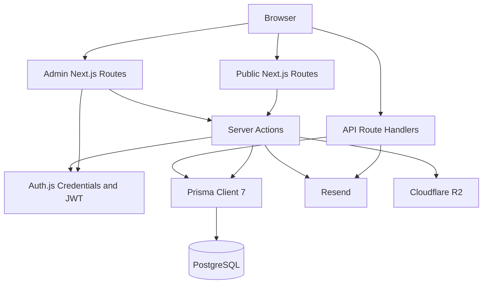
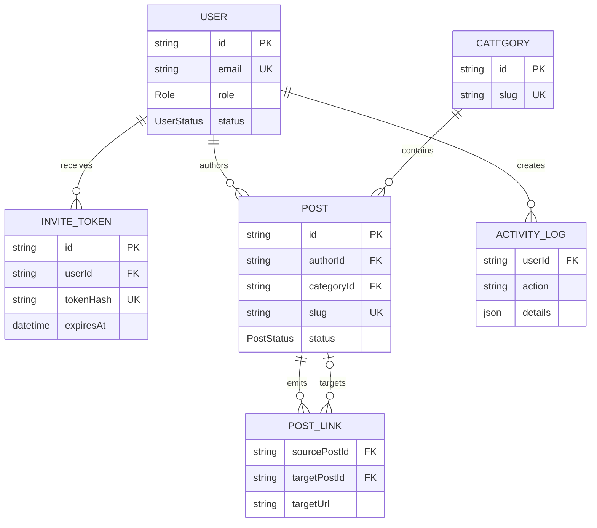
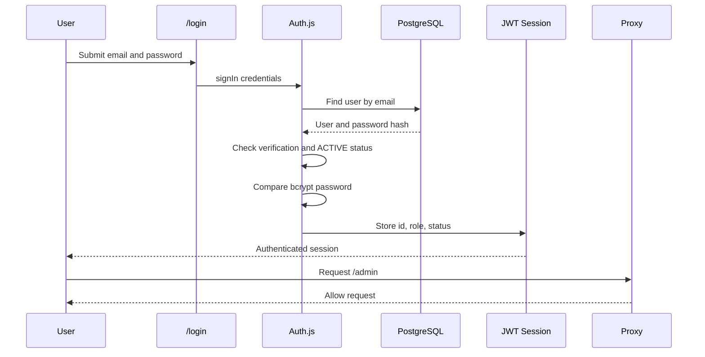
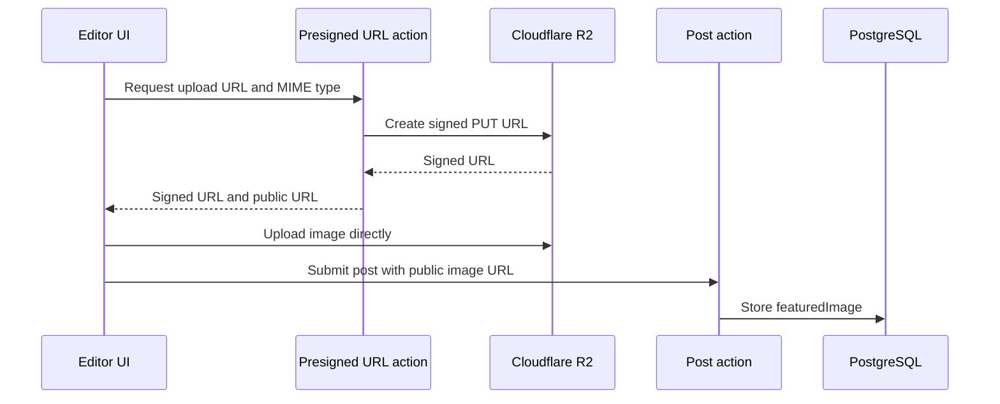
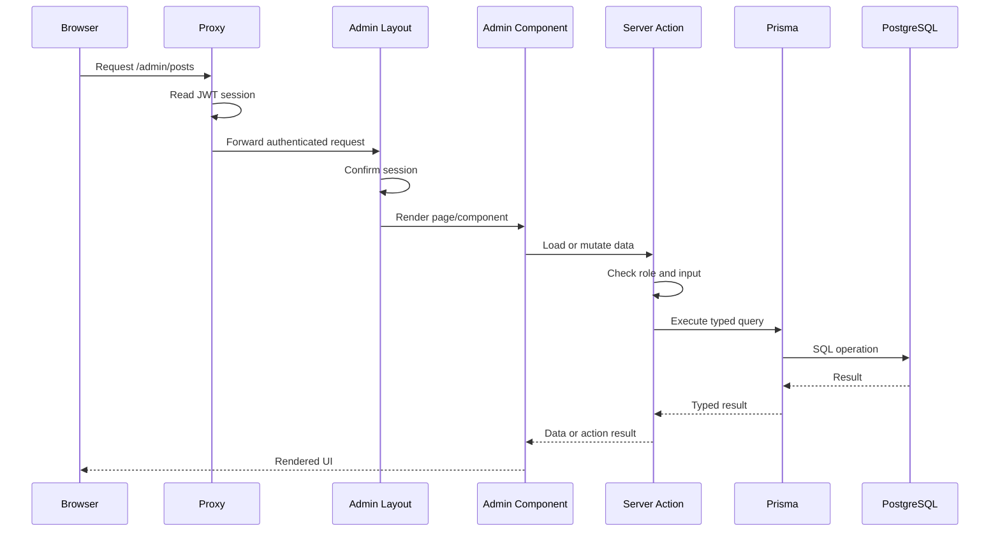
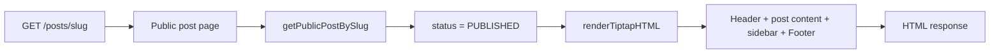
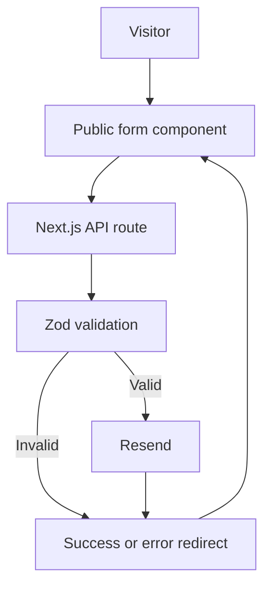

# Cyload Project Documentation

This document describes the Cyload application as implemented in the repository. It is intended for developers who need to understand the project structure, data model, request flows, feature ownership, and operational dependencies.

## Table of Contents

1. [System Overview](#1-system-overview)
   1. [Purpose and Runtime](#11-purpose-and-runtime)
   2. [High-Level Architecture](#12-high-level-architecture)
   3. [Directory Map](#13-directory-map)
2. [Application Structure](#2-application-structure)
   1. [Next.js App Router](#21-nextjs-app-router)
   2. [Modules and Components](#22-modules-and-components)
   3. [Shared Infrastructure](#23-shared-infrastructure)
3. [Database and Prisma Schema](#3-database-and-prisma-schema)
   1. [Prisma Configuration](#31-prisma-configuration)
   2. [Enums](#32-enums)
   3. [Models](#33-models)
   4. [Relationships](#34-relationships)
   5. [Database Lifecycle](#35-database-lifecycle)
4. [Authentication and Authorization](#4-authentication-and-authorization)
   1. [Authentication Configuration](#41-authentication-configuration)
   2. [Login Flow](#42-login-flow)
   3. [Invitation and Verification Flows](#43-invitation-and-verification-flows)
   4. [Password Reset](#44-password-reset)
   5. [Route Protection and Permissions](#45-route-protection-and-permissions)
5. [Public Website](#5-public-website)
   1. [Public Layout](#51-public-layout)
   2. [Marketing Pages](#52-marketing-pages)
   3. [Public Posts](#53-public-posts)
   4. [SEO and Indexing](#54-seo-and-indexing)
6. [Admin CMS](#6-admin-cms)
   1. [Admin Shell and Dashboard](#61-admin-shell-and-dashboard)
   2. [Post Management](#62-post-management)
   3. [Category Management](#63-category-management)
   4. [User Management](#64-user-management)
   5. [Settings](#65-settings)
7. [Editor and Media](#7-editor-and-media)
   1. [Tiptap Editor](#71-tiptap-editor)
   2. [HTML Rendering](#72-html-rendering)
   3. [Cloudflare R2 Uploads](#73-cloudflare-r2-uploads)
8. [API Routes and External Services](#8-api-routes-and-external-services)
   1. [Auth API](#81-auth-api)
   2. [Audit API](#82-audit-api)
   3. [Contact API](#83-contact-api)
   4. [Download API](#84-download-api)
   5. [Resend and Calendly](#85-resend-and-calendly)
9. [End-to-End Flows](#9-end-to-end-flows)
   1. [Content Publishing](#91-content-publishing)
   2. [Admin Request Flow](#92-admin-request-flow)
   3. [Public Post Request Flow](#93-public-post-request-flow)
   4. [Lead Capture](#94-lead-capture)
10. [Configuration and Operations](#10-configuration-and-operations)
    1. [Environment Variables](#101-environment-variables)
    2. [Development Commands](#102-development-commands)
    3. [Seed Data](#103-seed-data)
    4. [Build and Deployment](#104-build-and-deployment)
11. [Known Gaps and Maintenance Notes](#11-known-gaps-and-maintenance-notes)
12. [File-by-File Responsibility Index](#12-file-by-file-responsibility-index)

## 1. System Overview

### 1.1 Purpose and Runtime

Cyload is a Next.js 16 application combining a public marketing website with an authenticated content-management system. The public side presents services, pricing, resources, contact forms, and published posts. The admin side provides dashboards and CRUD workflows for posts, categories, users, and account settings.

The main runtime layers are:

- **Next.js App Router:** route definitions, server-rendered pages, layouts, metadata, loading states, and API route handlers.
- **React 19:** interactive client components and admin forms.
- **Prisma 7:** typed database access against PostgreSQL through `@prisma/adapter-pg`.
- **Auth.js / NextAuth:** credentials login, JWT sessions, verification checks, and admin route protection.
- **Resend:** transactional email for verification, invitations, password resets, contact, audit, and resource-download notifications.
- **Cloudflare R2:** object storage for post featured images through the S3-compatible API.
- **Tiptap:** rich-text editing and HTML conversion for posts.

The application is server-first. Pages and server actions perform most database work on the server, while client components handle forms, editor interaction, upload progress, table controls, and navigation.

### 1.2 High-Level Architecture



A typical request is handled by a route page or API handler. The route composes server and client components. Forms invoke server actions or API routes. Data access is centralized through the Prisma client in `src/lib/db.ts`. Authentication information is added to JWT/session claims and checked at the proxy, layout, or action boundary.

### 1.3 Directory Map

```text
.
├── prisma/
│   └── schema.prisma                 Database schema
├── public/                           Static assets
├── scripts/
│   └── seed.ts                       Development/initial data seed
├── src/
│   ├── app/                          Next.js routes and layouts
│   │   ├── (public)/                 Public route group
│   │   ├── admin/                    Protected CMS route group
│   │   └── api/                      HTTP API route handlers
│   ├── brand/                        Brand constants and presentation config
│   ├── components/client/            Public-facing reusable components
│   ├── components/ui/                Generic shared UI components
│   ├── generated/prisma/             Generated Prisma client output
│   ├── lib/                          Shared infrastructure
│   ├── modules/                      Feature ownership boundaries
│   │   ├── auth/
│   │   ├── categories/
│   │   ├── dashboard/
│   │   ├── editor/
│   │   ├── marketing/posts/
│   │   ├── posts/
│   │   ├── settings/
│   │   ├── upload/
│   │   └── users/
│   └── types/                        TypeScript declarations
├── next.config.ts                    Next.js configuration
├── prisma7.config.ts                 Prisma CLI configuration
├── package.json                      Scripts and dependencies
└── tsconfig.json                     TypeScript path/build settings
```

## 2. Application Structure

### 2.1 Next.js App Router

The `src/app` directory is the executable route tree. Folder names become URL segments unless they are route groups such as `(public)`, which organize layouts without appearing in the URL.

- `src/app/layout.tsx` is the root layout shared by every route.
- `src/app/(public)/layout.tsx` wraps public pages with the public header/footer presentation.
- `src/app/admin/layout.tsx` wraps authenticated CMS pages and performs an additional session check.
- `src/app/api/**/route.ts` contains HTTP handlers for integrations and form submissions.
- `loading.tsx` files provide route-level loading UI for admin pages.
- `robots.ts` and `sitemap.ts` expose generated SEO metadata endpoints.

The route page normally owns composition, while feature behavior is delegated to a module action and reusable components. This keeps route files small and makes the same action available to multiple UI surfaces.

### 2.2 Modules and Components

The `src/modules` directory groups behavior by business capability rather than by technical type.

| Module            | Responsibility                                                                                |
| ----------------- | --------------------------------------------------------------------------------------------- |
| `auth`            | Setup, login, logout, invitations, email verification, password reset, and permission helpers |
| `categories`      | Category CRUD, validation, pagination, and category admin UI                                  |
| `dashboard`       | Admin shell, navigation, metrics, and recent-post presentation                                |
| `editor`          | Tiptap editor configuration, toolbar controls, and HTML rendering                             |
| `marketing/posts` | Published-post queries and public post components                                             |
| `posts`           | Post CRUD, post forms, tables, SEO fields, and delete controls                                |
| `settings`        | Current-user settings query/update and settings form                                          |
| `upload`          | R2 presigned URLs and upload handling                                                         |
| `users`           | User lookup, update, deletion, invitations, and user tables/forms                             |

Public presentation components live under `src/components/client`. They are grouped by page concern such as `homepage`, `services`, `pricing`, `resources`, `about`, `legal`, and `free-audit`. Generic UI primitives such as pagination live under `src/components/ui`.

### 2.3 Shared Infrastructure

`src/lib/db.ts` exports the one application Prisma client. The `@/*` TypeScript alias points to `src/*`, allowing routes and modules to import shared infrastructure as `@/lib/db`, `@/auth`, or `@/generated/prisma`.

Authentication is split into two files because the proxy may run in an edge-compatible context:

- `src/auth.config.ts` contains edge-safe callbacks and session configuration without database or Node-only imports.
- `src/auth.ts` adds the credentials provider and database-backed authorization checks.

`src/brand/brand.config.ts` centralizes brand labels, URLs, contact details, and presentation constants consumed by public components.

## 3. Database and Prisma Schema

### 3.1 Prisma Configuration

`prisma/schema.prisma` declares a PostgreSQL datasource and generates the Prisma client into `src/generated/prisma`. Prisma 7 is configured through `prisma7.config.ts`; runtime access uses `PrismaPg` and a `pg.Pool` in `src/lib/db.ts`.

The generated directory is build output and should not be hand-edited. Changes belong in `prisma/schema.prisma`, followed by Prisma generation and any required database migration/deployment operation.

### 3.2 Enums

#### `Role`

`SUPERADMIN`, `ADMIN`, `EDITOR`, and `REVIEWER` describe the intended user roles. Role checks are implemented in action files and the permission helper rather than enforced by database constraints.

#### `UserStatus`

`PENDING` represents an account that has not completed activation, `ACTIVE` permits authentication, and `DEACTIVATED` blocks login.

#### `PostStatus`

`DRAFT` keeps a post out of the public publishing queries. `PUBLISHED` makes it eligible for public post pages and sitemap inclusion when `noIndex` is false.

### 3.3 Models

#### `User`

Stores identity, optional password hash, role, account status, verification timestamp, and timestamps. A user owns invite tokens, authored posts, and activity logs. The database table is `users`.

#### `InviteToken`

Stores a hashed invitation token belonging to a user, an expiry time, optional usage time, and creation time. Deleting a user cascades to its invite tokens. The table is `invite_tokens`.

#### `PasswordResetToken`

Stores a reset token identified by email, with expiry and creation timestamps. The token is unique and the `(email, token)` pair is also unique.

#### `Category`

Stores a unique category name/slug and optional description. A category can contain many posts. The table is `categories`.

#### `Post`

Stores the title, unique slug, Tiptap content string, publishing status, SEO metadata, featured-image data, AEO/GEO JSON blocks, author/category relations, publication timestamp, and timestamps. The table is `posts`.

The JSON fields are:

- `faqs`: expected to contain question/answer objects.
- `quickFacts`: expected to contain label/value objects.

#### `PostLink`

Tracks links leaving one post. `targetUrl` stores the destination, while `targetPostId` optionally connects it to another local post. The source relation cascades on source deletion; the optional target relation is set to null when the target is deleted. The table is `post_links`.

#### `ActivityLog`

Stores an action string, optional JSON details, optional user ownership, and a timestamp. User deletion preserves the log and clears its user reference. The table is `activity_logs`.

### 3.4 Relationships



### 3.5 Database Lifecycle

At runtime, `db` is created from `DATABASE_URL` using a PostgreSQL pool with SSL enabled, wrapped by `PrismaPg`, and passed to the generated `PrismaClient`. During development, the client is stored on `globalThis` to prevent repeated hot-reload connections.

Server actions and API handlers import this singleton and issue typed Prisma queries. Public post reads filter by publication status; admin reads include drafts and management metadata. Database errors are generally caught at the route/action boundary and converted into an error result or logged server-side.

## 4. Authentication and Authorization

### 4.1 Authentication Configuration

Authentication is implemented with Auth.js / NextAuth using the credentials provider. The browser submits an email and password to the Auth.js sign-in flow. The provider looks up the user in PostgreSQL, compares the submitted password with the stored bcrypt hash, and returns identity data for the JWT callback.

The JWT contains the user ID, role, and status. The session callback copies those values onto `session.user`, with TypeScript declarations in `src/types/next-auth.d.ts` extending the Auth.js types. Sessions use the JWT strategy rather than a database session table.

`src/auth.config.ts` is deliberately free of database and Node-only imports so it can be used by the proxy. `src/auth.ts` contains the real credentials provider and database checks.

### 4.2 Login Flow



The provider rejects missing credentials, unknown users, users without a password, unverified emails, pending accounts, deactivated accounts, and incorrect passwords. Successful authentication redirects to the admin area through the configured redirect callback.

### 4.3 Invitation and Verification Flows

The initial setup and invitation workflows create a pending user and send a time-limited email link through Resend. The token stored in the database is hashed; the raw token is placed only in the URL sent to the recipient.

The setup flow is:

1. `/setup` submits the setup secret and first-user details.
2. `setup.action.ts` validates the setup token and confirms that a superadmin does not already exist.
3. A `User` and `InviteToken` are created.
4. Resend sends a verification/activation link.
5. `/verify-email` hashes the received token and calls `verify-email.action.ts`.
6. The user is marked active, `emailVerifiedAt` is set, and the token is removed.

The invited-user flow uses `/accept-invite` and `AcceptInviteForm`. The action checks token existence and expiry, hashes the new password, activates the user, marks the email verified, and removes the invite token.

### 4.4 Password Reset

`password-reset.action.ts` owns both reset stages:

- The request stage accepts an email, creates a token with an expiry, stores it in `PasswordResetToken`, and sends a reset link through Resend.
- The confirmation stage validates the token and expiry, hashes the replacement password, updates the matching user, and removes reset tokens for that email.

The public pages are `/forgot-password` and `/reset-password`. The reset action is intentionally separate from normal credentials login, so reset links can be consumed without an existing session.

### 4.5 Route Protection and Permissions

`src/proxy.ts` creates an Auth.js proxy from the edge-safe config. It:

- Allows `/api/auth/**` to complete.
- Redirects an authenticated visitor away from `/login` to `/admin`.
- Redirects unauthenticated requests for `/admin/**` to `/login`.
- Allows public routes and other API routes to continue.

The proxy matcher excludes Next.js internals, static assets, and common image extensions.

`src/app/admin/layout.tsx` performs a second authentication check inside the server-rendered admin boundary. Feature actions then perform their own role checks before mutations. `src/modules/auth/permissions.ts` contains reusable role helpers, but the repository review found some action files using local role checks instead of consistently calling the central helpers.

Authentication and authorization are therefore separate concerns:

```mermaid
flowchart LR
   Request[Incoming request]
   Proxy[Auth proxy]
   Layout[Admin layout session check]
   Action[Server action role check]
   Mutation[Database mutation]

   Request --> Proxy
   Proxy -->|Unauthenticated admin request| Login[/login]
   Proxy -->|Authenticated| Layout
   Layout -->|No session| Login
   Layout -->|Session exists| Action
   Action -->|Role allowed| Mutation
   Action -->|Role denied| Error[Action error]
```

## 5. Public Website

### 5.1 Public Layout

The `(public)` route group contains the public-facing site without adding `public` to any URL. Its layout composes the shared `Header` and `Footer`, while the root layout supplies global HTML metadata, fonts, and styles.

Public pages are primarily server components. They compose focused client components for interactive behavior such as mobile navigation, forms, pricing controls, editor-like content presentation, or Calendly embeds.

### 5.2 Marketing Pages

The public routes and their primary ownership are:

| Route                                 | Main responsibility                                                     | Main component area                            |
| ------------------------------------- | ----------------------------------------------------------------------- | ---------------------------------------------- |
| `/`                                   | Homepage sections, service positioning, proof, FAQ, and resource teaser | `components/client/homepage`                   |
| `/about`                              | Company introduction, values, and founder content                       | `components/client/about`                      |
| `/services`                           | Services index and navigation                                           | `components/client/services-index`             |
| `/services/local-seo`                 | Local SEO service detail and FAQ                                        | `components/client/services/local-seo`         |
| `/services/website-design-redesign`   | Website design service detail and FAQ                                   | `components/client/services/website-design`    |
| `/services/patient-retention`         | Patient retention service detail and FAQ                                | `components/client/services/patient-retention` |
| `/services/social-media`              | Social media service detail and FAQ                                     | `components/client/services/social-media`      |
| `/pricing`                            | Pricing hero, plans, billing explanation, and FAQ                       | `components/client/pricing`                    |
| `/resources`                          | Resource listing                                                        | `components/client/resources`                  |
| `/resources/recall-message-templates` | Resource content and download form                                      | `components/client/resources/single`           |
| `/free-audit`                         | Audit explanation and lead form                                         | `components/client/free-audit`                 |
| `/contact`                            | Contact information and contact form                                    | `components/client/contact`                    |
| `/privacy-policy`                     | Privacy policy content                                                  | `components/client/legal`                      |
| `/cookie-policy`                      | Cookie policy content                                                   | `components/client/legal`                      |
| `/terms`                              | Terms content                                                           | `components/client/legal`                      |
| `/login`                              | Credentials login entry point                                           | Auth module and public route                   |
| `/forgot-password`                    | Password reset request                                                  | Auth module and public route                   |
| `/reset-password`                     | Password replacement                                                    | Auth module and public route                   |
| `/accept-invite`                      | Invited-user activation                                                 | `modules/auth/components`                      |
| `/verify-email`                       | Email verification                                                      | Auth module and public route                   |
| `/not-found`                          | Public not-found presentation                                           | `components/client/error`                      |

Most marketing text is defined directly in the page-specific components. Shared calls to action are implemented by `AuditCta`, while `Header` and `Footer` provide global navigation and contact/brand links.

### 5.3 Public Posts

The public post index is `/posts`. Its page uses the marketing-post actions to load published posts and categories, then passes the data to filtering, featured-post, card, sidebar, and pagination components.

The post detail route is `/posts/[slug]`. Its data path is:

1. The route receives the slug parameter.
2. `getPublicPostBySlug` queries a published post and its category/author data.
3. `renderTiptapHTML` converts the stored Tiptap content into display HTML.
4. The page renders `SinglePostHeader`, `SinglePostHeroImage`, and `SinglePostContent`.
5. `PostSidebar` loads or receives related published content for navigation.

Drafts are excluded from public reads. The public listing supports category filtering and pagination through query parameters handled by the route/component pair.

### 5.4 SEO and Indexing

`src/app/robots.ts` emits the robots response using `NEXT_PUBLIC_APP_URL`. `src/app/sitemap.ts` combines a fixed list of public routes with published posts where `noIndex` is false. Post `updatedAt` values become sitemap `lastModified` values.

Post SEO fields are maintained through `PostSeoDetails` and stored on the `Post` record:

- `metaTitle`
- `metaDescription`
- `canonicalUrl`
- `featuredImage`
- `imageAltText`
- `noIndex`

The sitemap query is guarded by a `try/catch`, so a database failure logs an error and still returns static routes. The canonical application URL falls back to `https://stevarlabs.co.uk` when the environment variable is absent.

## 6. Admin CMS

### 6.1 Admin Shell and Dashboard

The admin area begins at `/admin`. `src/app/admin/layout.tsx` verifies that a session exists before rendering the CMS shell. `DashboardShell` composes the admin header, sidebar, content area, and responsive navigation controls.

The dashboard page calls `getDashboardMetrics` and displays:

- Counts of posts, published posts, categories, and users.
- Recent posts with status, author, category, and date information.
- Welcome and navigation content from the dashboard components.

The dashboard components are split by visual responsibility: `AdminHeader`/`header` for the top bar, `sidebar` for navigation, `DashboardMetricsGrid` for counts, `RecentPostsTable` for recent content, and `DashboardWelcomeBanner` for the introductory panel.

### 6.2 Post Management

Post administration is exposed through:

- `/admin/posts`: post list and management table.
- `/admin/posts/create`: new post form.
- `/admin/posts/[id]/edit`: existing post editor.
- `/admin/posts/[id]/preview`: rendered preview of a post.

The ownership chain is:

| UI                    | Action                                  | Database responsibility                                    |
| --------------------- | --------------------------------------- | ---------------------------------------------------------- |
| `PostsTable`          | `getPostsAction`                        | List posts with management fields and pagination/filtering |
| `CreatePostForm`      | `createPostAction`                      | Validate and create a draft or published post              |
| `EditPostForm`        | `getPostByIdAction`, `updatePostAction` | Load and update post content/metadata                      |
| `DeletePostButton`    | `deletePostAction`                      | Delete a post after permission checks                      |
| `PostBasicDetails`    | Included by create/edit forms           | Title, slug, category, author, status, and content basics  |
| `PostSeoDetails`      | Included by create/edit forms           | SEO, image, canonical, and indexing fields                 |
| `FeaturedImageUpload` | `getPresignedUrlAction` and upload flow | Store a public R2 image URL on the post                    |

Posts require an author and category relation. Publishing sets or uses `publishedAt` as part of the lifecycle data. The public queries later use the `PUBLISHED` status to determine visibility.

The preview page loads the post by ID and passes its stored content through the Tiptap HTML renderer. It is an admin preview surface, not the public slug route.

### 6.3 Category Management

`/admin/categories` loads categories through `getCategoriesAction`, which supports the category table and pagination. The page uses responsive desktop/mobile components and modal forms.

Category mutations are separated into:

- `create-category.action.ts`: creates a category after validation and authorization.
- `update-category.action.ts`: changes category fields and slug data.
- `delete-category.action.ts`: removes a category subject to the database relationship rules.
- `category.actions.ts`: shared/legacy category action surface present alongside the focused action files.
- `utils.ts`: slug/validation helpers used by category behavior.

`CategoryTable`, `CategoryDesktop`, `CategoryMobile`, and `CategoryModals` form the presentation layer. The UI chooses the responsive view; server actions remain the authority for mutation validation.

### 6.4 User Management

User administration is exposed at `/admin/users` with `/admin/users/create` for the creation/invitation surface. The UI is built from `UserTable`, `CreateUserForm`, and `invite-user`.

The action ownership is:

- `getallusers.action.ts`: list users for the admin table.
- `getuser.action.ts`: fetch one user for settings/details.
- `update.action.ts`: update permitted user fields.
- `delete.action.ts`: remove a user while respecting relational constraints.
- `invite.action.ts`: create an invited user/token and send an activation email.

Invitations do not immediately establish a usable password. The recipient completes the flow through `/accept-invite`, which sets the password and activates the account.

### 6.5 Settings

`/admin/settings` loads the current user through `getUserAction` and renders `SettingsForm`. The form submits to `updateSettingsAction`, which updates profile information and, where supported, password/email settings.

Settings is a user-account feature rather than a global site-configuration store. Brand and marketing constants remain in `src/brand/brand.config.ts` and component code; they are not edited through the settings page.

## 7. Editor and Media

### 7.1 Tiptap Editor

The post editor is implemented in `src/modules/editor/components/RichTextEditor.tsx` with toolbar controls in `EditorToolbar.tsx`. It uses Tiptap StarterKit plus extensions for:

- Images
- Links
- Text alignment
- Underline
- Standard rich-text marks and blocks from StarterKit

The editor produces a Tiptap JSON document that is serialized into the `Post.content` string field. `CreatePostForm` and `EditPostForm` embed the editor and include the serialized value in their server-action payload.

### 7.2 HTML Rendering

`src/modules/editor/utils/render-html.ts` converts stored Tiptap content into HTML using `@tiptap/html` and the matching extensions. The renderer is used by the admin preview and public post detail surfaces.

The result is inserted into the page as HTML by the content components. This makes the extension configuration part of the content contract: changes to supported Tiptap nodes or marks must be reflected in both editor and renderer configuration.

### 7.3 Cloudflare R2 Uploads

Featured-image uploads use the S3-compatible Cloudflare R2 API:

1. The client selects or prepares an image.
2. `getPresignedUrlAction` validates the request and creates a short-lived signed PUT URL.
3. The browser uploads directly to R2 using that URL.
4. The action returns or the client constructs the public URL using `R2_PUBLIC_URL`.
5. The post form stores the URL in `Post.featuredImage` and the alternative text in `Post.imageAltText`.

`upload.action.ts` contains the server-side upload support, while `presigned-url.action.ts` owns presigned URL generation. Credentials stay on the server; the browser receives only the scoped upload URL.



## 8. API Routes and External Services

### 8.1 Auth API

`src/app/api/auth/[...nextauth]/route.ts` exports the Auth.js handlers from `src/auth.ts` for the standard authentication endpoints. The route is intentionally allowed through `src/proxy.ts` so sign-in, callback, session, and sign-out requests can complete.

The credentials provider itself performs the database lookup and password comparison. The API route is an adapter between Auth.js and the Next.js App Router rather than a second authentication implementation.

### 8.2 Audit API

`POST /api/audit` is used by the free-audit form. The handler:

1. Parses the submitted form/body data.
2. Validates the payload with Zod.
3. Sends an internal notification email through Resend.
4. Sends a confirmation or follow-up email to the submitter where configured.
5. Redirects the browser to the audit page with success or error state.

The API does not persist audit leads in the Prisma schema. Email delivery is the current durable handoff.

### 8.3 Contact API

`POST /api/contact` receives the contact form. It validates the fields with Zod, sends a notification through Resend, and redirects back to the contact page with the result. The contact submission is not stored in a database table.

`ContactSection` owns the form presentation; the route handler owns validation and email delivery.

### 8.4 Download API

`POST /api/download` handles the resource download form for the recall-message templates. It validates the email/marketing preference payload, sends an email containing a resource URL, and redirects to a success/error state.

The current resource URL is configured in the route implementation and must point to a real R2/public asset before production use. Download consent is not currently represented by a database model.

### 8.5 Resend and Calendly

Resend is used from auth actions and public API handlers. Its responsibilities include:

- Account verification emails.
- Invitation emails.
- Password reset emails.
- Free-audit notifications and follow-up.
- Contact notifications.
- Resource download delivery.

Calendly is used by public marketing components, including the pricing/contact or audit scheduling experience. `react-calendly` supplies React integration while the page-level component controls placement and the surrounding call to action.

Other notable external dependencies are:

- PostgreSQL for application data.
- Cloudflare R2 for media.
- `next/font/google` for the selected site font.
- `picsum.photos` placeholder imagery in seed data.

## 9. End-to-End Flows

### 9.1 Content Publishing

```mermaid
flowchart TD
   Create[/admin/posts/create]
   Form[CreatePostForm]
   Action[createPostAction]
   DB[(PostgreSQL Post)]
   Edit[/admin/posts/id/edit]
   Update[updatePostAction]
   Public[/posts/slug]
   Query[getPublicPostBySlug]

   Create --> Form
   Form --> Action
   Action --> DB
   DB --> Edit
   Edit --> Update
   Update --> DB
   DB --> Query
   Query --> Public
```

The post begins as a form payload containing basic details, rich-text content, category/author references, status, and SEO fields. The create action validates authorization and writes the record. Editors can later update the same record. Once its status is `PUBLISHED`, public queries can return it; `noIndex` independently controls sitemap inclusion.

### 9.2 Admin Request Flow



### 9.3 Public Post Request Flow



The public post route does not use the admin post action. It uses the marketing-post query surface so draft and management-only data remain outside the public presentation boundary.

### 9.4 Lead Capture

Audit, contact, and resource-download forms use a similar boundary:



These flows currently use email as the handoff mechanism. They do not create lead, consent, or submission records in PostgreSQL.

## 10. Configuration and Operations

### 10.1 Environment Variables

| Variable               | Used by                                | Purpose                             |
| ---------------------- | -------------------------------------- | ----------------------------------- |
| `DATABASE_URL`         | `src/lib/db.ts`, Prisma                | PostgreSQL connection string        |
| `NEXT_PUBLIC_APP_URL`  | Auth emails, metadata, robots, sitemap | Public application base URL         |
| `RESEND_API_KEY`       | Auth actions and API routes            | Resend API authentication           |
| `SETUP_TOKEN`          | `setup.action.ts`                      | Secret for first-admin bootstrap    |
| `R2_ACCOUNT_ID`        | Upload actions                         | Cloudflare account identifier       |
| `R2_ACCESS_KEY_ID`     | Upload actions                         | R2 S3 access key                    |
| `R2_SECRET_ACCESS_KEY` | Upload actions                         | R2 S3 secret key                    |
| `R2_BUCKET_NAME`       | Upload actions                         | Target R2 bucket                    |
| `R2_PUBLIC_URL`        | Upload/post forms                      | Public base URL for uploaded images |
| `NODE_ENV`             | `src/lib/db.ts`                        | Development singleton behavior      |

The seed command explicitly loads `.env.local`. The runtime also requires the deployment environment to provide the same values through its normal environment configuration.

### 10.2 Development Commands

The package scripts are:

```bash
pnpm dev       # Start the Next.js development server
pnpm build     # Generate Prisma client and build Next.js
pnpm start     # Start the production Next.js server
pnpm lint      # Run ESLint
pnpm seed      # Run scripts/seed.ts with .env.local
```

After changing `prisma/schema.prisma`, regenerate the Prisma client before typechecking or building. Database schema changes should be applied using the project’s Prisma workflow appropriate to the target environment.

### 10.3 Seed Data

`scripts/seed.ts` creates development/initial content using Prisma. It is the place to inspect for the initial account/content assumptions and sample categories/posts. Seeded post imagery includes placeholder URLs, so seed assets are not necessarily production assets.

The seed script should be run only against an intended database. It loads `.env.local`, so verify that file points to the correct PostgreSQL instance before running it.

### 10.4 Build and Deployment

The production build runs `prisma generate` before `next build`, ensuring the generated client matches the checked-in schema. The application then runs with `next start` and needs:

1. A reachable PostgreSQL database.
2. The required environment variables.
3. A working Resend sender/domain configuration.
4. A configured R2 bucket and public URL for image uploads.
5. A correctly configured `NEXT_PUBLIC_APP_URL` for redirects and email links.

The repository does not contain a separate deployment adapter or infrastructure definition. Deployment is therefore handled by the hosting platform’s Next.js runtime configuration.

## 11. Known Gaps and Maintenance Notes

The following items were visible during the source review and should remain part of the project’s maintenance context:

1. **Authorization is not fully centralized.** The permission helper and individual actions do not always enforce identical role rules. Review role checks when changing admin functionality.
2. **Invitation role input needs strict server enforcement.** The server must validate requested roles against the inviter’s authority and the Prisma enum, regardless of what the form offers.
3. **Account email changes and verification should stay aligned.** Changing an email address should be reviewed together with `emailVerifiedAt` semantics.
4. **Password reset policy is action-owned.** Keep the server-side password requirements at least as strict as the client-side form requirements and decide how reset interacts with deactivated/unverified accounts.
5. **Rendered post HTML is trusted.** Any expansion of editor capabilities should be accompanied by explicit HTML sanitization and URL policy decisions.
6. **Uploads need production controls.** Consider file-size limits, content verification, rate limiting, quotas, abandoned-object cleanup, and authorization on presigned URL requests.
7. **Lead forms are not persisted.** Audit/contact/download submissions rely on email delivery and have no durable database record, deduplication, or reporting view.
8. **Resource URLs and marketing content contain placeholders.** Confirm all public URLs, legal placeholders, contact details, sender identities, founder assets, and downloadable files before release.
9. **Some schema features are ahead of the UI.** `PostLink`, `ActivityLog`, `summary`, `faqs`, `quickFacts`, and related link-graph features exist in the schema but are not broadly used by current workflows.
10. **Duplicate or placeholder files exist.** Review `src/modules/categories/category.actions.ts`, `src/modules/posts/a.ts`, and `dummy.ts` before extending neighboring code.
11. **Database SSL is unconditional.** `src/lib/db.ts` always enables SSL, which may require adjustment for local PostgreSQL environments.
12. **The default README was stale before this documentation was added.** Keep the project README or this document updated when routes, dependencies, environment variables, or operations change.

These are documentation findings, not automatic fixes. They describe behavior and risk observed in the repository so future work can make deliberate changes.

## 12. File-by-File Responsibility Index

### Root and Configuration

| File                   | Responsibility                                                     |
| ---------------------- | ------------------------------------------------------------------ |
| `package.json`         | Dependencies, package manager, development/build/lint/seed scripts |
| `pnpm-lock.yaml`       | Locked dependency graph                                            |
| `tsconfig.json`        | TypeScript compiler and `@/*` path alias                           |
| `next.config.ts`       | Next.js configuration                                              |
| `prisma7.config.ts`    | Prisma CLI configuration                                           |
| `eslint.config.mjs`    | ESLint configuration                                               |
| `postcss.config.mjs`   | PostCSS/Tailwind processing                                        |
| `dummy.ts`             | Empty/placeholder root TypeScript file                             |
| `scripts/seed.ts`      | Seed data creation                                                 |
| `prisma/schema.prisma` | Authoritative database schema                                      |

### Runtime and Authentication

| File/area                                          | Responsibility                                                               |
| -------------------------------------------------- | ---------------------------------------------------------------------------- |
| `src/lib/db.ts`                                    | Prisma PostgreSQL singleton                                                  |
| `src/auth.ts`                                      | Credentials provider and database-backed Auth.js configuration               |
| `src/auth.config.ts`                               | Edge-safe JWT/session/redirect configuration                                 |
| `src/proxy.ts`                                     | Request-level login/admin protection                                         |
| `src/types/next-auth.d.ts`                         | Auth.js session/token type augmentation                                      |
| `src/modules/auth/*.action.ts`                     | Setup, login, logout, invitation, verification, and password reset workflows |
| `src/modules/auth/permissions.ts`                  | Reusable permission definitions/helpers                                      |
| `src/modules/auth/components/AcceptInviteForm.tsx` | Invitation acceptance UI                                                     |

### Routes

| Route area                                | Responsibility                                       |
| ----------------------------------------- | ---------------------------------------------------- |
| `src/app/layout.tsx`                      | Root HTML/layout and global metadata                 |
| `src/app/(public)/**`                     | Public pages and public layout                       |
| `src/app/admin/**`                        | Authenticated CMS pages, layouts, and loading states |
| `src/app/api/auth/[...nextauth]/route.ts` | Auth.js HTTP handler                                 |
| `src/app/api/audit/route.ts`              | Audit form validation and email delivery             |
| `src/app/api/contact/route.ts`            | Contact form validation and email delivery           |
| `src/app/api/download/route.ts`           | Resource download email flow                         |
| `src/app/robots.ts`                       | Robots metadata endpoint                             |
| `src/app/sitemap.ts`                      | Static and published-post sitemap generation         |

### Feature Modules

| Area                          | Responsibility                                                      |
| ----------------------------- | ------------------------------------------------------------------- |
| `src/modules/posts`           | Admin post CRUD, forms, tables, SEO fields, preview/delete controls |
| `src/modules/marketing/posts` | Public published-post queries and presentation components           |
| `src/modules/categories`      | Category CRUD, validation, responsive admin UI                      |
| `src/modules/users`           | User lookup, administration, invitation UI, and user mutations      |
| `src/modules/dashboard`       | Dashboard metrics, shell, navigation, and recent-post UI            |
| `src/modules/settings`        | Current-user settings query, update action, and form                |
| `src/modules/editor`          | Tiptap editor, toolbar, and content-to-HTML conversion              |
| `src/modules/upload`          | R2 upload and presigned URL actions                                 |

### Public Components and Branding

| Area                               | Responsibility                               |
| ---------------------------------- | -------------------------------------------- |
| `src/components/client/Header.tsx` | Public site navigation                       |
| `src/components/client/Footer.tsx` | Public site footer and contact/brand links   |
| `src/components/client/homepage`   | Homepage section composition                 |
| `src/components/client/services*`  | Services index and individual service pages  |
| `src/components/client/pricing`    | Pricing and billing/FAQ presentation         |
| `src/components/client/resources*` | Resource listing, content, and download form |
| `src/components/client/free-audit` | Audit page and audit form presentation       |
| `src/components/client/contact`    | Contact page presentation                    |
| `src/components/client/about`      | About page presentation                      |
| `src/components/client/legal`      | Privacy, cookie, and terms content           |
| `src/components/client/shared`     | Reusable public calls to action              |
| `src/components/client/error`      | Not-found presentation                       |
| `src/components/ui/Pagination.tsx` | Shared pagination control                    |
| `src/brand/brand.config.ts`        | Brand and public configuration constants     |

## Documentation Maintenance Rule

When adding or changing a feature, update the corresponding route, module, data-flow, environment-variable, and file-index entries in this document. Keep diagrams aligned with the actual call path, and treat `prisma/schema.prisma` as the source of truth for model names and relationships.
